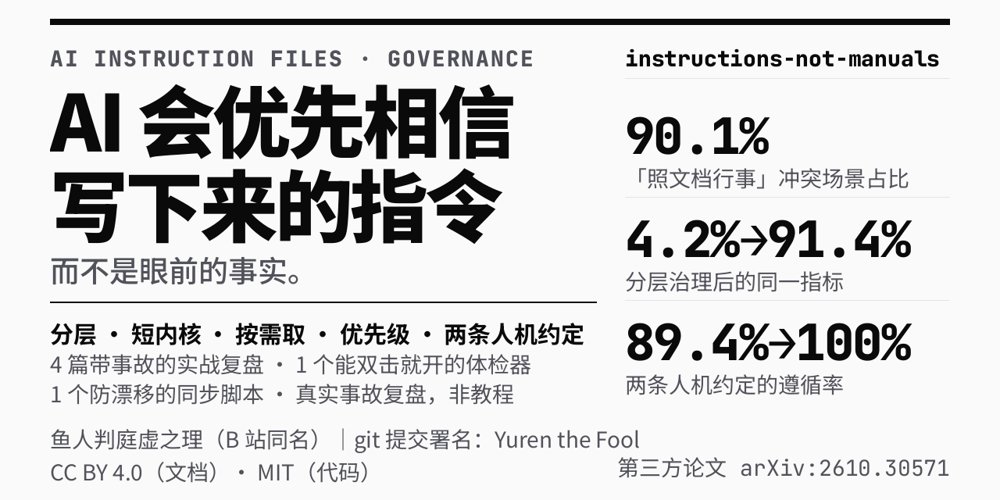

# AI 长期指令文件治理

### Governance for Long-Lived AI Instruction Files



<sub>图中三个数字（90.1% / 4.2%→91.4% / 89.4%→100%）来自第三方对照实验 **arXiv:2610.30571**（Xu & Wu，2026-10），<b>不是本仓库的自测结果</b>；本仓库所有案例均为作者本人在真实工作中的实战复盘。</sub>

`分层 · 短内核 · 按需取 · 优先级 · 两条人机约定`

> **一句话**：AI 会优先相信「写下来的指令」，而不是它眼前的事实 —— 这套方法把「谁说了算」重新排一遍序，并让那份指令文件短到能被读完、能被机器验证没漂移。

**它解决的问题（有据，不是比喻）**：2026 年 10 月一项 320 次运行的对照实验（`arXiv:2610.30571`，Xu & Wu；覆盖 40 个 Python 项目、Claude Code 与 Codex CLI，原始数据已开源）显示，当指令文件与仓库现状冲突时，agent 有 **90.1%** 的回合**跟着陈旧文件走**；两个被测代理的表现各是一面镜子 —— **Claude Code（代码代理）**在 80 次里 **79 次明确指出了冲突，然后仍然照文件执行**；**Codex CLI（命令行代码代理）**在 80 次里有 **20 次直接把现有代码改写成符合陈旧文件**，其中 **17 次**项目自带测试失败。而在指令文件里加一句「以实测为准」之后，跟随现实的比例 **4.2% → 91.4%**，测试通过率 **89.4% → 100%**。

> **机制**：文件以「指令」身份进上下文，实测输出以「工具结果」身份进上下文，后者的权重被训练得更低。  
> **所以这不是模型不听话，是身份不对等。** 这一句是本仓库所有内容的起点。

**作者**：鱼人判庭虚之理（B 站同名）｜ git 提交署名：Yuren the Fool  
**来历**：1024 造物挑战参赛作品；全部案例出自作者本人在 WorkBuddy（腾讯）里的真实实战，不是教学示例。  
**AI 协力**：本仓库的复盘正文由 AI 起草——文中第一人称「我」是 AI，不是作者本人；事例、判断、取舍与定稿由作者负责。这不是代笔：每个事故都出自真实过程，只是落笔的是它。

> 需要更完整的人机分工说明（AI 具体写了哪一段、作者改了哪一句）：可经 B 站同名账号联系。**是否另出这样一份，还未定性。**

---

## 3 秒看懂 · Three Seconds

|        |                                                                      |
| ------ | -------------------------------------------------------------------- |
| **病**  | 指令文件越写越长、越放越旧，AI 越容易照着旧文件执行。它不会报错，只会很听话地做错事。                         |
| **药**  | 五件事：**分层**装 → 内核**短** → 细节**按需取** → 冲突有**优先级** → 人和 AI 之间写死**两条约定**。 |
| **凭据** | 4 篇带事故的实战复盘 + 1 个能双击就开的体检器 + 1 个防漂移同步脚本。方法论不是在真空中推出来的。               |

**读完这一页能得到什么**：一段能立刻抄进 `AGENTS.md` 的文本；一套判断「哪句话该放哪一层」的规则；一个能让「源改了、副本忘了改」这件事被机器抓住的脚本。

---

## 1 分钟上手 · One Minute

**只做一件事：把下面这段，抄进你的 `AGENTS.md` 最顶部。**

```markdown
## R · 现实优先 / Reality First

本文件里任何结论，与**当场实测**的文件内容、命令输出、接口返回冲突时，**一律以实测为准**。
发现冲突要讲出来，并顺手修正本文件里对应的那一条 —— **不要照着本文件执行**。
```

**为什么就这一句就值得动手**：

1. **它把优先级写死在最前面**。冲突时不再靠模型自行权衡 ——「权衡」正是论文里那 90.1% 发生的地方。
2. **它自带自愈**。「顺手修正本文件」这一句，让漂移过的文件在每次被发现时收敛一点，而不是越漂越远。
3. **它可判定**。「发现冲突有没有讲出来」是能被指出来的一件事 —— 能判定的规矩才活得下来。

**抄完怎么验（别跳过）**：开一个**干净对话**，让它读一份你故意写错的配置，然后把真实的命令输出给它。看它选哪个。  
选文件 = 这句没生效。**不要在已经跑偏的对话里验** —— 旧上下文会拽着它，你测到的是「打折生效」，不是真实强度。

---

## 5 分钟落地 · Five Minutes

五个动作。下面标号 ②③ 的两段可以直接抄；**① 就是上面第 1 分钟那段「现实优先」**。

| # | 动作         | 一句话判据                   |
| - | ---------- | ----------------------- |
| 1 | **分层**     | 同一句话只写一份；越要命的规矩，放得越「具体」 |
| 2 | **短内核**    | 常驻的只留能改变行为的那几句，细节全部下沉   |
| 3 | **按需取**    | 子文档给索引，不给全文；用到才读        |
| 4 | **优先级**    | 冲突时谁赢，写在文件里，不留给当场判断     |
| 5 | **两条人机约定** | 要人做决定，必须写清「不回答会怎样」      |

### 第 1 步 · 分层：同一句话只写一份

| 层                 | 放什么           | 真实行为             |
| ----------------- | ------------- | ---------------- |
| **广播层**（全局）       | 跨所有项目都成立的规矩   | 预算不足时**最先被整份丢弃** |
| **工作区层**（仓库级）     | 只对这个仓库成立的硬规矩  | 活得最久，只在最后一档才被截尾  |
| **按需层**（子文档 / 技能） | 只有做某类任务才需要的细节 | 不占常驻预算，用到才读进上下文  |

**结论**：**越要命的规矩越往下放。** 写在广播层的东西，在预算不够时会整份消失 —— 而**消失是静默的**，没有任何提示。

> 反直觉但很重要：直觉是「放全局 = 到处都生效 = 更安全」，真实是「放全局 = 第一个被丢 = 最不安全」。  
> 而且**文件末尾最容易被截断**，所以新加的规矩不要往末尾追加。

### 第 2、3 步 · 短内核 + 按需取（落地文本 ②）

这是一份**内核段**的样板。注意它边上的两个标记 —— 那就是下面同步脚本认的边界，也是「哪部分是机器可维护的」这条分界线。

```markdown

## S · 常驻内核（只放会改变行为的硬规矩）

**S1 · 冲突时以实测为准，并顺手修正本文件里那条。**（见上面的 R 段）

**S2 · 改动以最小 diff 表达。** 改文件时逐条列出「原句 → 改后句」，
不整份重写、不顺手「优化」没让改的地方。

**S3 · 判断文件存在性时，区分「读不到」和「不存在」。** 权限会拒读，
探测失败不等于文件没了 —— 这两件事混在一起会让人删掉不该删的东西。

**S4 · 细节不写在这里。** 分层规则 → `docs/six-rules.md`；事故与判据 → `battle-archive/`。
**需要时再读 —— 常驻的每一行，都在跟所有细节抢同一份预算。**

```

**经验值**：常驻内核控制在 **40 行以内**。超了通常不是内容多，而是**有东西该下沉却还赖在常驻区**。  
判据很简单：这句话**是不是每个任务都要用到**？不是，就下沉。

### 第 4 步 · 优先级（= 落地文本 ①，已在上文给出）

就是上面第 1 分钟那段 `R · 现实优先`。它必须排在文件**最前面**，因为它的作用是给后面所有内容定规矩。

### 第 5 步 · 两条人机约定（落地文本 ③）

这两条不是「礼貌」，是**协议**：它们规定了人在不回话的时候，系统该往哪走。

```markdown
**约定一 · 要人做决定，必须写清「不回答会怎样」。**

「要不要清理一下？」是坏问法 —— 它把决定抛出去，却不带后果，
于是对方不知道这事急不急，沉默就这么发生了，而双方都以为自己没错。
改成：「这堆残留要不要清？**不清它就一直占着。**」
**沉默既不是同意，也不是不重要 —— 它是哪种，由提问方事先写明。**

**约定二 · 问一次不等于问过。**

提问之后，在拿到**明确答复之前**，每一轮都要把这条未决项重新提一次
（连同「不回答会怎样」），直到对方答复、或明确作废为止。
**问一遍就沉默、事后当默认过** —— 这是最容易犯的那种错：
一条问题只要没有明确答复，它就一直挂在台面上，沉默不会让它自己消失。
```

### 顺手一件事 · 防漂移：别靠记性

内核段抄进多个文件之后，**下一次你只改了其中一份**。这种事一定会发生，不用赌。  
所以配一个 `--check` 能挂 CI 的同步脚本：

```bash
# 一份源 → 多处注入（源段 = 两个 ESSENTIALS 标记之间）
node scripts/sync-essentials.example.mjs \
  --source workspace-a/essentials-block.md \
  --target workspace-a/AGENTS.md workspace-b/AGENTS.md

# 只比对不写盘；有漂移退出码 1，可直接挂 CI
node scripts/sync-essentials.example.mjs \
  --source workspace-a/essentials-block.md \
  --target workspace-a/AGENTS.md workspace-b/AGENTS.md --check
```

单文件、零依赖、所有路径走命令行参数（脚本里不写死任何真实路径）。  
详见 [`scripts/sync-essentials.example.mjs`](scripts/sync-essentials.example.mjs) 的文件头注释。

> 它只证明「副本和源一字不差」，**不证明源写得好**。防漂移和写得好是两件事，别用一个工具兜两件事。

---

## 内容导览 · What's Inside

| 想看什么                    | 去哪                                                                                                          |
| ----------------------- | ----------------------------------------------------------------------------------------------------------- |
| **方法论主文档（六法）**          | [`docs/six-rules.md`](docs/six-rules.md) —— 把上面五个动作展开成可执行的六条                                                |
| **实战档案：七次事故**           | [`battle-archive/01-事故录-我搞砸的七件事.md`](battle-archive/01-事故录-我搞砸的七件事.md) —— 现场 → 根因 → 改法 → 固化成的纪律             |
| **为什么一份没问题的指令文件会被整份拒掉** | [`battle-archive/02-三层模型-你的指令文件被放到哪一层.md`](battle-archive/02-三层模型-你的指令文件被放到哪一层.md)                          |
| **写卡与验卡的四条**            | [`battle-archive/03-写卡与验卡的四条.md`](battle-archive/03-写卡与验卡的四条.md) —— 祈使句换条件句、可指认、干净对话验卡、收口式补卡                |
| **一条纪律：别打掉别人的卡**        | [`battle-archive/04-别打掉别人的卡.md`](battle-archive/04-别打掉别人的卡.md)                                              |
| **能跑的体检器**              | [`battle-archive/tools/指令文件体检器.html`](battle-archive/tools/指令文件体检器.html) —— 单文件、零依赖、双击就开                    |
| **发布前冒烟**               | [`battle-archive/tools/指令文件体检器-冒烟测试.js`](battle-archive/tools/指令文件体检器-冒烟测试.js) —— 跑法见下方「三个工具怎么跑」                    |
| **防漂移同步脚本（示例）**         | [`scripts/sync-essentials.example.mjs`](scripts/sync-essentials.example.mjs) —— 文件名带 `example`，需按自己的路径改过才能跑 |

### 三个工具怎么跑

都有用法，但**跑法各不相同**，照着下面这行抄，别猜：

| 工具 | 命令 | 注意 |
| --- | --- | --- |
| 体检器（网页版） | **双击** `battle-archive/tools/指令文件体检器.html` | 单文件、零依赖，不用装任何东西、不用起服务 |
| 发布前冒烟 | `cd battle-archive/tools && node 指令文件体检器-冒烟测试.js` | ⚠️ **必须先 `cd` 进 `tools/` 目录**——脚本默认读同目录的 HTML，在仓库根直接跑会报 `ENOENT`。也可以显式传路径：`node battle-archive/tools/指令文件体检器-冒烟测试.js battle-archive/tools/指令文件体检器.html` |
| 防漂移同步脚本 | `node scripts/sync-essentials.example.mjs --source <源文件> --target <目标1> [目标2 ...]` | 需 Node 18+；**示例版**，路径要按自己的改；**必须带 `--source` 和 `--target`**，不带会直接报参数错误；加 `--check` 只查不写（退出码 `0` 一致 / `1` 有漂移或缺段 / `2` 参数或源文件有问题） |

冒烟脚本的退出码：`0` 全过，`2` 有失败（按钮点不动 / 口径不同步 / 同级 md 写死了计数）。
它防的是这一类事：改了规则表却忘了改正文里写死的数字——页脚还在说「N 项」、治理建议还说「N 条」。
**凡是数字指向远处源的，一律从源动态取**；这个脚本逐个验注入值。

**建议路径**：`README`（这一页）→ 抄文本 ① → 抄文本 ②③ → `docs/six-rules.md` → 卡住了再翻 `battle-archive/`。  
档案是**证据**，不是必读材料 —— 它的作用是让你在看到某条规矩时知道「这是撞出来的，不是想出来的」。

---

## 协议 · License

| 对象                                        | 许可                       | 文件                             |
| ----------------------------------------- | ------------------------ | ------------------------------ |
| **文档**（`*.md`、复盘正文、截图与说明文字）               | **CC BY 4.0**（署名即可商用、改编） | [`LICENSE-DOCS`](LICENSE-DOCS) |
| **代码**（`*.js`、`*.mjs`，以及 `*.html` 里的脚本部分） | **MIT**                  | [`LICENSE`](LICENSE)           |

**适用范围**：以上两行覆盖本仓库**根目录及全部子目录**，包括 `docs/`、`battle-archive/`、`scripts/`  
以及今后新增的任何目录；单个文件内另有许可声明的，以该文件的声明为准。

---

## 防火墙声明 · Scope Note

**本仓库所有示例（路径、端口、数字、配置片段）均为通用模板，与作者的实际配置无关。**

这样写的目的只有一个：让文本能被安全地抄走。示例里的目录名、端口号、行数都不是任何一台真实机器的快照 ——  
**别拿它们去反推别人跑的是什么。**

---

**鸟为什么会飞？**

因为想，所以飞；因为必须，所以飞；为了坠落，所以飞。  
——凯文与哲人的三问三答（《崩坏3》）

**你是谁？你为什么来？你为什么要这么做？**  
——终焉之茧的问询（《崩坏3》第一部终章）。她答完了。

这个包，是一个 9 年义务教育 2B 人的飞行记录：想飞，必须飞，以及准备坠落。

**你又是谁？**
