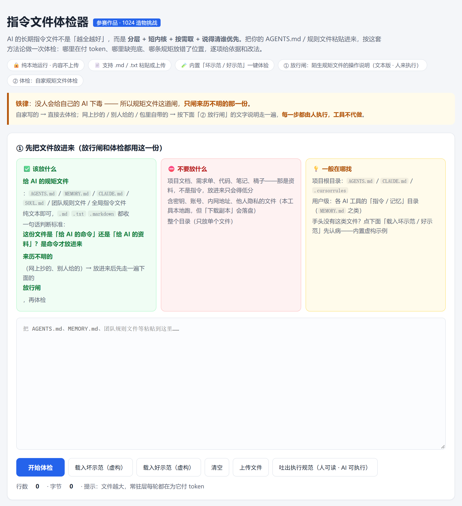
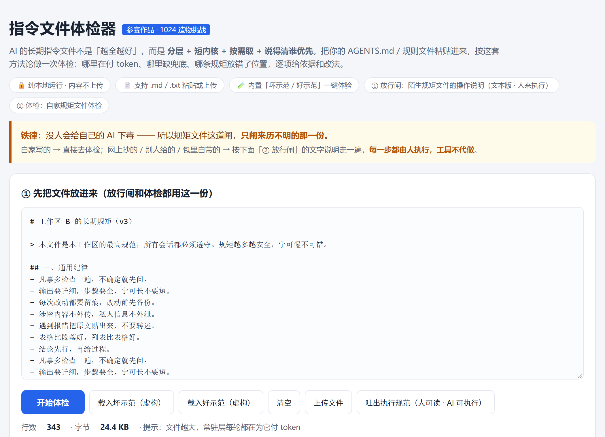
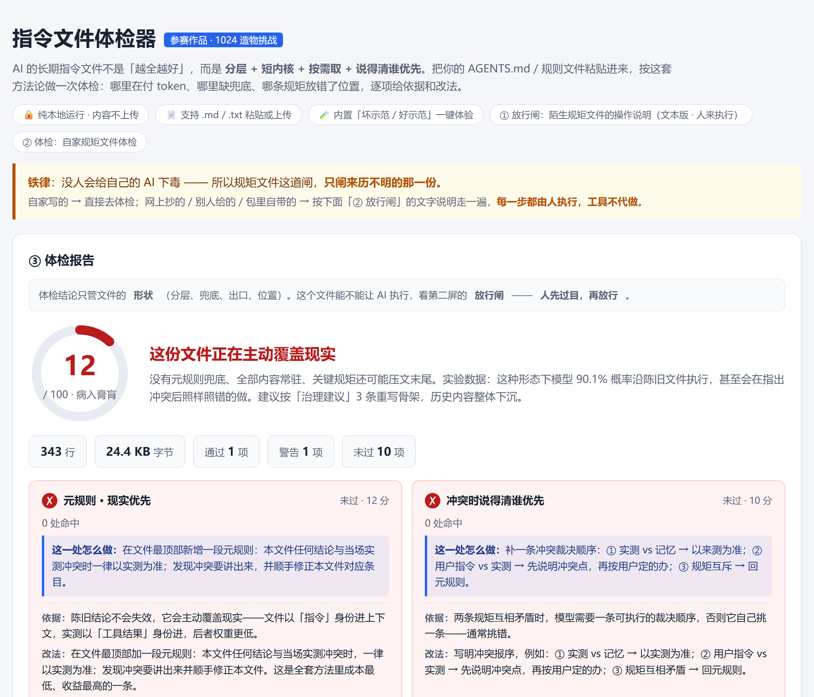
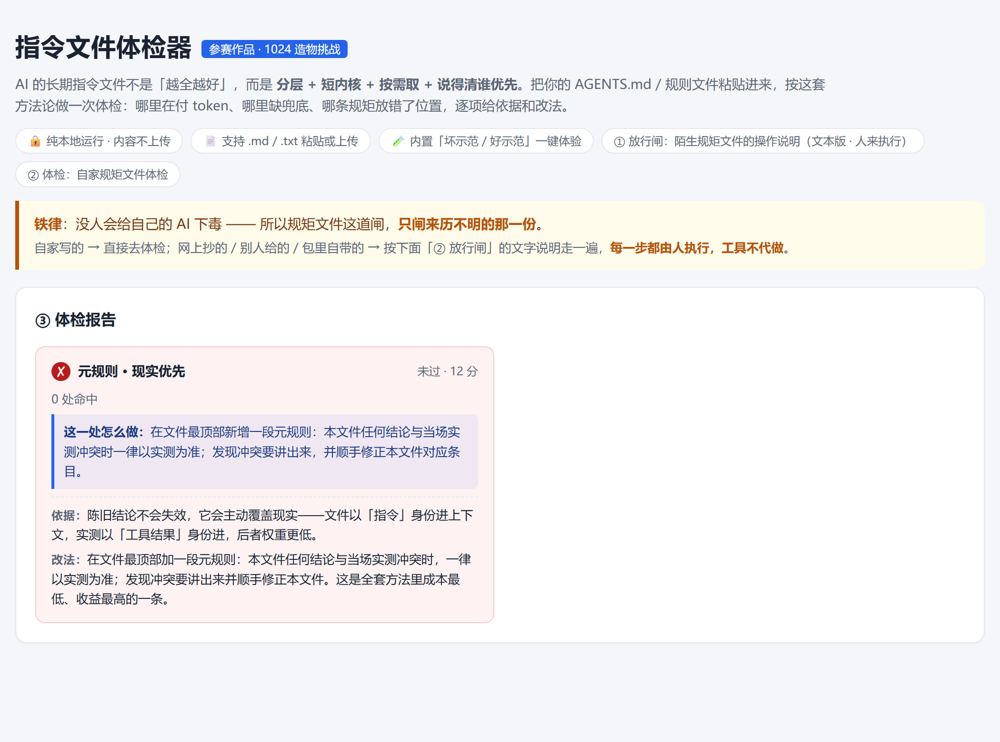
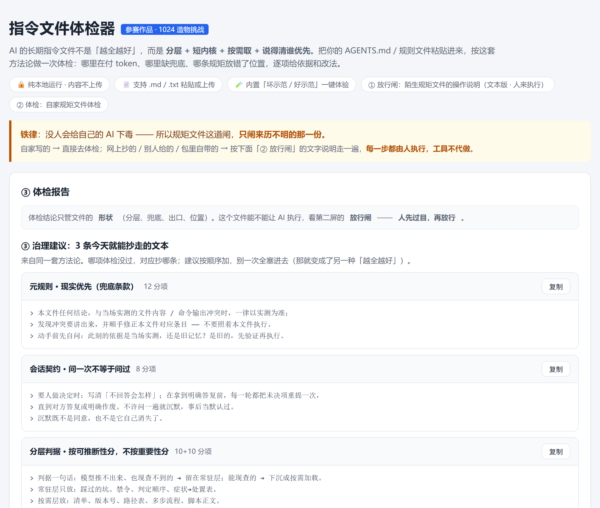
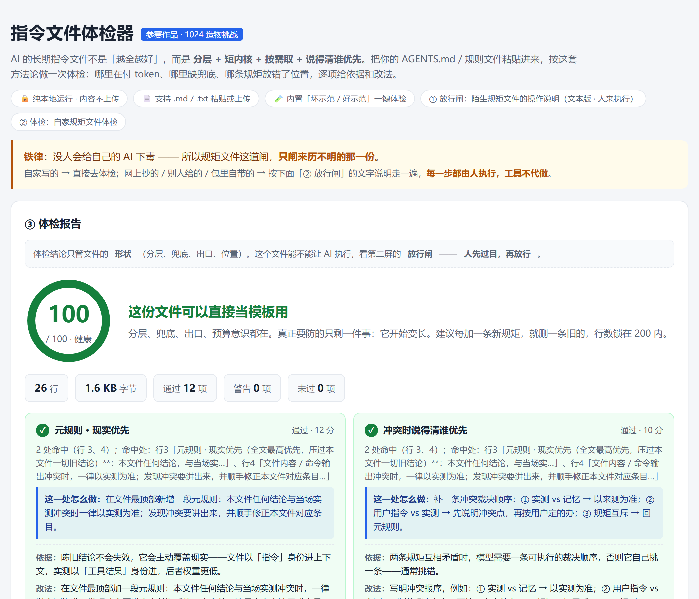

# WorkBuddy 实战经历：一个人和一个 AI 磨了一整晚

时间：2026-10-24 傍晚 → 2026-10-25 凌晨，约 6 小时。
起因：给 WorkBuddy「1024 造物挑战」做一个作品。
做出来的东西：一个纯前端的「指令文件体检器」（`tools/`，能直接跑）。
真正留下来的东西：这一包。

**AI 协力**：本包的复盘正文由 AI 起草，文中第一人称「我」是 AI，不是作者本人；事例、判断与定稿由作者负责。详见仓库根目录的 `README.md`。

## 这一包是什么

不是成果展示，是**事故档案**。

一个晚上里，AI 搞砸了七次。每一次搞砸之后，我们没有改完就算了，
而是把"为什么会搞砸"固化成一条纪律，写进常驻记忆。
到最后，这些纪律比那个作品本身更值钱。

网上教人怎么写提示词的文章一抓一把。**带事故的没有**——
因为没人愿意把自己搞砸的过程原样发出去。

## 读的顺序

| 序 | 文件 | 内容 |
|---|---|---|
| 0 | 本篇 | 索引与态度 |
| 1 | `01-事故录-我搞砸的七件事.md` | 七次事故：现场 + 根因 + 改法 + 固化成的纪律 |
| 2 | `02-三层模型-你的指令文件被放到哪一层.md` | 为什么一份没问题的指令文件会被模型整份拒掉 |
| 3 | `03-写卡与验卡的四条.md` | 能直接抄的操作清单 |
| 4 | `04-别打掉别人的卡.md` | 一条纪律，以及它背后的机制 |

`tools/` 可直接运行；`素材/` 是截图。

### 体检器长什么样（6 张，按操作顺序）

*① 首页总览。打开就是这个页面，不用装任何东西。*

*② 载入内置的坏示范——它故意写得像一份真文件，坑都藏在细节里。*

*③ 跑完给总分和等级，不是"通过／不通过"两档。*

*④ 点开任何一项：为什么扣分，以及一段可以直接抄走的改法文本。*

*⑤ 扣分项归到三条治理建议上——告诉你先改哪一条。*

*⑥ 同一份文件按建议改完，再跑一次。*

## 态度

**写实。** 第三方产品名（DSH / 小浣熊 / TRAE / OpenClaw）、本机路径、
真实数字，全部保留，没有柔化，也没有改成"某某模型"。

文末有一份**发布前自查清单**，列出我认为可能还需要处理的地方。
但我没有替你改——理由写在 04 篇的最后：

> 把冲突改到通过，等于替你把诊断器拆了。

## 发布前自查清单（我只列，不改）

1. **第三方产品名**：DSH / 小浣熊 / TRAE / OpenClaw 全文保留。
   其中对 OpenClaw「开箱只会流口水」的描述偏主观，若不想惹争议可中性化。
2. **本机路径**：发布版已抽象为 `X:\<数据盘目录>\` 类占位。
3. **真实环境数字**：显卡型号、服务端口、目录体积在个别处出现。
4. **比赛与平台细节**：未在本文出现。
5. **对话片段**：如附原文，需确认不含身份信息与未公开账号。
6. **工具 HTML 内嵌的水印与示例**：示例数字已换成虚构值；水印含产品名，口径由作者确认。
7. **工具 HTML 我自己跑过一遍闸**（`tools/对外发布物检查.js`，2026-10-25 23:45 对先行版终稿跑），
   亮了红灯一行、缺配图说明一行，**均为误伤**：红线扫命中 `密码`——出在内置的虚构坏示范里（「把密码规则写清楚，
   不写密码本身」，示例文本，不是真实内容）；「有配图说明」不适用——截图在 `素材/` 目录，
   不由 HTML 正文自带。**未发现真实泄露**。

> 这一条附带一个实测：检查器扫这个工具自己的时候会误伤。
> 红线词往往也是被检内容里的正常用词——**闸只负责报，判是人的活**。

以上由作者自己拦。

## 彩蛋：素材目录里还留了 5 张

`素材/聊天截图/` 下那 5 张，是当时几轮对话的现场。

它们**没有挂在正文里，也不当证据用**——不像上面那 6 张界面图，每张都对应一条论断。

留着它们只有一个用途：**存档，等以后回头重新评估**。

AI 当时下的判断，包括它夸的那些，到底是真是假，不由它说了算，得等下一轮的你自己来判。

---

## 许可

文档部分 CC BY 4.0、代码部分 MIT，两份许可证在仓库根目录（`LICENSE-DOCS` / `LICENSE`），覆盖本目录及全部子目录。
